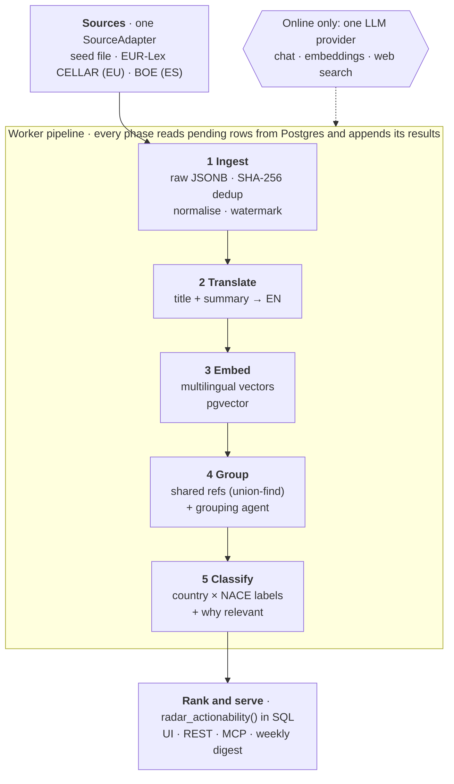

# Regulatory Radar

A self-hosted radar for chambers and associations. It streams EU and national regulatory items, collapses them into one entry per procedure, decides relevance per EU country × NACE Rev. 2.1 code and ranks the result by actionability. The brief is in [docs/CHALLENGE.md](docs/CHALLENGE.md).

## Run it (under 5 minutes)

```bash
git clone <repo> && cd regulatory_radar
docker compose up --build          # http://localhost:8080 (UI) · /api/docs (OpenAPI) · /mcp (MCP)
docker compose run --rm eval       # recall/precision per profile against both eval sets
```

- **Offline (default):** no key, no network, seed file only.
- **Online:** copy `.env.example` to `.env` and set `LLM_PROVIDER=mistral` + `MISTRAL_API_KEY` or `LLM_PROVIDER=openai` + `OPENAI_API_KEY`. One provider serves chat (tool calling), multilingual embeddings and web search. `MISTRAL_SERVER_URL=https://api.eu.mistral.ai` keeps inference in the EU, but without web search.
- **Live sources:** `SOURCE_EURLEX_ENABLED=true`, `SOURCE_BOE_ENABLED=true`. `SOURCE_FILE_ENABLED=false` drops the seed file (use an empty `POSTGRES_DATA_DIR`, since the database is append-only).
- **State:** Postgres only, one database per mode (`radar_offline`, `radar_online`) in `./.pgdata`. `docker compose down && up` keeps everything.
- **Presets:** one click selects an example profile (Metals · Austria, Retail · Spain, Agri-food · Poland), mapped from NACE Rev. 2 to Rev. 2.1 ([mapping notes](docs/nace-rev2-to-rev2.1.md)).
- **Develop in the dev container** (`.devcontainer/`), so a compromised npm package cannot reach your home directory. With npm 12, `allowScripts` only runs approved install scripts.

## Architecture



## Pipeline

Ingestion streams new records. Stages 2 to 5 run in a loop (`PIPELINE_INTERVAL_SECONDS`), each picking up what is pending in Postgres, so the worker is stateless and restart-safe. Every result row stores its engine id (`deterministic`, `mistral:…`, `agent:openai:…`), and the read models are refreshed after each cycle.

| Stage           | What it does                                                                                                                                                                                                                                                                                                    | Offline                                    |
| --------------- | --------------------------------------------------------------------------------------------------------------------------------------------------------------------------------------------------------------------------------------------------------------------------------------------------------------- | ------------------------------------------ |
| **1 Ingest**    | Streams each source from its watermark (a day, EUR-Lex rescans 7 days). Stores the payload verbatim (SHA-256 dedup), then normalises it: ISO country and language, NACE Rev. 2 tags → Rev. 2.1, reference key, action points (deadlines, votes, adoption). Invalid records stay raw, listed as rejected.        | same                                       |
| **2 Translate** | Title and summary to English; originals kept.                                                                                                                                                                                                                                                                   | skipped                                    |
| **3 Embed**     | Multilingual embeddings (1024 or 3072 dims, pgvector HNSW); texts over 8,192 tokens are compacted once. The NACE taxonomy is embedded once per model.                                                                                                                                                           | skipped                                    |
| **4 Group**     | Shared `ref` or `related_to` (reactions) always merge (union-find). An agent reviews every group and may join it with another group of the same jurisdiction, only with high confidence. A group is named after its first streamed item, so names are stable.                                                   | refs only                                  |
| **5 Classify**  | Labels per (country × NACE code): `relevant`, `borderline`, `not_relevant`, each with a rationale, plus a "why relevant". EU items expand to all 27 member states. Stated tags are always relevant. A label that was relevant once **stays tracked**. Online: 2 agent runs, a third on a tie, majority decides. | multilingual concept lexicon + stated tags |

**The agents** (LangGraph ReAct loop, max. 12 steps, 4 tool calls per turn):

- **Tools:** embedding neighbours, Postgres full-text search, read-only SQL (SELECT-only role, 5 s timeout), the provider's `web_search`, `fetch_url`. The classifier also gets `search_nace` (words + semantic search over Eurostat notes) and `nace_notes`.
- **Instructions:** grouping: what is and is not the same procedure, with worked examples. Classification: who carries the obligation along the value chain, size thresholds, information-only caps, keyword traps.
- **Checked in code:** final answers are validated against their schema. Unknown NACE codes and wrong titles go back for correction (max. 2 rounds). Sectors the rules flag but the agent skipped are added as borderline. A failed run is retried after 1, then 5 minutes (3 attempts). Meanwhile the deterministic result is shown.

## Ranking: how the list is ordered

The UI shows the API's order unchanged. One immutable SQL function, `radar_actionability(action_points, stage, as_of)`, assigns each procedure group a tier. The query then sorts by:

1. **Tier**: ① open consultation or feedback window → ② upcoming vote or amendment deadline → ③ standstill period → ④ in procedure → ⑤ adopted → ⑥ information only. Tiers ① to ③ need a date on or after `as_of` (today, or `RADAR_AS_OF`). An expired deadline drops to the stage tier.
2. **Action date**, soonest first (none last).
3. **Verdict**: relevant before borderline.
4. **Latest publication**, newest first.
5. **Group key**, so equal entries never swap: same input, same output.

The default view shows relevant + borderline for the selected country (plus EU level) and NACE codes at any level (`C`, `C24`, `C24.4` match hierarchically via `ltree`). **NEW** marks groups first seen after the last "Mark all as seen".

## Matching and fast retrieval

- **Labels are profile-independent:** one row per (group × country × NACE code). EU groups get all 27 countries, national groups only their own.
- **Country:** EU-level groups plus groups of the selected countries.
- **NACE:** codes are `ltree` paths (`C24.4` → `NACE.C.C24.C24_4`). `C24` matches `NACE.C.C24.*` (itself and below), `NACE.C` (section) and `NACE` (all sectors). Never siblings like `C25`. The strongest matching verdict wins.
- **Fast reads:** the UI never reads the append-only tables. Materialized views (latest group snapshot, its labels) are refreshed concurrently after each pipeline cycle. A GiST index on `(country, nace_path)` answers the match, and one SQL query does scope → match → rank → page, including the denominator.

## Evaluation

```bash
docker compose run --rm eval   # scores the running stack (starts it if needed)
scripts/eval.sh offline        # same on a fresh stack; writes docs/eval/offline.json
scripts/eval.sh online         # fresh stack with the provider from .env
```

- **Two label sets, same 53 items:** [`labels.json`](data/eval/labels.json) (standard, unchanged, `metals_at`, `retail_es`) and [`labels.extended.json`](data/eval/labels.extended.json) (ours, all three profiles: three independent model annotators, majority vote, 158/159 agreement, then a sceptical reviewer). The 4 of 90 labels where they differ are argued in [`disagreements.md`](data/eval/disagreements.md).
- **Shown** = relevant + borderline (the default view). **strict** = relevant only. **tier agreement** = exact tier, borderline included. Profiles are scored with their Rev. 2.1 selections.
- **Also checked:** F2, grouping pair precision/recall and group names, jurisdiction leaks, "why relevant" coverage, ranking determinism, tier order.

| Offline (deterministic)              | Recall | Precision | F2   | Strict P/R  | Tier agreement | Grouping P/R |
| ------------------------------------ | ------ | --------- | ---- | ----------- | -------------- | ------------ |
| `labels.json` · metals_at            | 1.00   | 1.00      | 1.00 | 1.00 / 0.86 | 0.93           | 1.00 / 1.00  |
| `labels.json` · retail_es            | 1.00   | 1.00      | 1.00 | 1.00 / 1.00 | 0.98           | 1.00 / 1.00  |
| `labels.extended.json` · agrifood_pl | 1.00   | 1.00      | 1.00 | 1.00 / 1.00 | 1.00           | 1.00 / 1.00  |
| `labels.extended.json` · metals_at   | 1.00   | 1.00      | 1.00 | 1.00 / 1.00 | 1.00           | 1.00 / 1.00  |
| `labels.extended.json` · retail_es   | 1.00   | 1.00      | 1.00 | 1.00 / 1.00 | 1.00           | 1.00 / 1.00  |

Every run: 0 jurisdiction leaks, 100 % "why relevant", all procedure groups reproduced under their label names. The differences on `labels.json` are exactly the 4 documented disagreements. **These are training-set scores:** the offline lexicon was tuned on these items.

**Online (one complete fresh run each):**

| Provider                                      | Extended set                                                          | `labels.json` metals_at strict R / tiers | Details                                          |
| --------------------------------------------- | --------------------------------------------------------------------- | ---------------------------------------- | ------------------------------------------------ |
| OpenAI `gpt-6-luna`, `text-embedding-3-large` | recall/precision 1.00; 1 tier off (`AT-PAR-0016`)                     | 0.79 / 0.91                              | [online-openai.md](docs/eval/online-openai.md)   |
| Mistral `mistral-small-2603`, `mistral-embed` | 100 %, all tiers exact (1 of 45 groups on the deterministic fallback) | 0.86 / 0.93                              | [online-mistral.md](docs/eval/online-mistral.md) |

The two online runs used different prompt versions, so they are not a model comparison.

**What moved the numbers most:**

1. **Offline:** exclusions per concept instead of global ("industrial consumers" hid the energy-intensive signal for metals), and capping at borderline for information-only items, rules without duties and concepts touching a minority of a sector.
2. **Online:** the OpenAI Responses API (Chat Completions refused tools: every run fell back), then majority consensus over 2 or 3 agent runs against run-to-run variance, then general value-chain rules in the prompt.

## Tests

| Command                                | What                                                                                                                                                                           |
| -------------------------------------- | ------------------------------------------------------------------------------------------------------------------------------------------------------------------------------ |
| `npm run test:unit -w apps/api`        | NACE hierarchy and Rev. 2 → 2.1 mapping, grouping and stable names on the real seed, watermarks, offline relevance = extended set exactly, agent answer checks, providers, MCP |
| `npm run test:integration -w apps/api` | Postgres 19 (testcontainers): dedup, rejected records, ranking determinism, jurisdiction, persistence, RFC 9457, digest; online path with a scripted LLM                       |
| `npm run test -w apps/web`             | Label helpers, warning banner                                                                                                                                                  |
| `npm run test -w e2e`                  | Playwright against `docker compose up`: AT × C24 ranking, persistence, sources, phone layout                                                                                   |

## Decision log

1. **Postgres is the only state, append-only.** New rows supersede old ones. Materialized views give the current state. Auditability and "new since" for free.
2. **Recall over precision.** Default view = relevant + borderline. An LLM can add and rank, never silently remove (stays tracked).
3. **Relevance is profile-independent.** Labels per (country × NACE path) in `ltree`. The operator's profile never reaches an LLM.
4. **Deterministic core, LLM at the edges.** Ingestion, ref grouping and ranking are pure. Agent results are stored with their engine id and reused, so output is reproducible.
5. **One provider, two databases.** Mistral or OpenAI behind LangChain interfaces. Offline and online results never mix.
6. **Live sources EUR-Lex CELLAR and BOE:** official, keyless, date-addressable, so the watermark is a day. A failed day keeps it back and marks the source `degraded`.
7. **NACE Rev. 2.1 only.** Rev. 2 is mapped once at the edge with Eurostat's correspondence (a little broader by design).
8. **My steering decisions:** NACE Rev. 2.1 instead of Rev. 2. OpenAPI as the single contract (client, validation, MCP). Separate databases per mode. An extended eval set built blind and the standard set left untouched. The switch to OpenAI's Responses API. Majority consensus over several agent runs. Only general prompt rules, never item-specific fixes.
9. **Left rough:** no auth/TLS. The offline lexicon is tuned to the seed. EUR-Lex gives titles only (no consultation deadlines, the Have-your-say API would add them). One online run per provider.

Key prompts and where I steered: [docs/agent-log.md](docs/agent-log.md).

## Self report

Time invested: **8 hours**, with Claude Code as the coding agent.

## Repository guide

[AGENTS.md](AGENTS.md) (agent rules) · [docs/agent-log.md](docs/agent-log.md) · [docs/presentation.html](docs/presentation.html) · [code-review/REVIEW.md](code-review/REVIEW.md) (Part B) · [THIRD_PARTY.md](THIRD_PARTY.md)

## Licence

Apache-2.0. See [LICENSE](LICENSE) and [NOTICE](NOTICE).
