# Regulatory Radar

Self-hosted radar for chambers and associations. It streams EU and national regulatory items, groups them per procedure, and decides relevance per EU country × NACE Rev. 2.1 code. Results are ranked so that open consultation windows come first. The brief is in [docs/CHALLENGE.md](docs/CHALLENGE.md).

## Run it (under 5 minutes)

```bash
git clone <repo> && cd regulatory_radar
docker compose up --build          # http://localhost:8080 (UI) · /api/docs (OpenAPI) · /mcp (MCP)
docker compose run --rm eval       # recall/precision per profile against both eval sets
```

The default run is **offline**: no key, no network, seed file only. For **online** mode, copy `.env.example` to `.env` and set `LLM_PROVIDER=mistral` with `MISTRAL_API_KEY` (EU-hosted inference) or `LLM_PROVIDER=openai` with `OPENAI_API_KEY` (US/global). One provider serves both the tool-calling chat model and the multilingual embeddings. Enable the live sources with `SOURCE_EURLEX_ENABLED=true` / `SOURCE_BOE_ENABLED=true`; switch off the seed file with `SOURCE_FILE_ENABLED=false` (live sources only). Items already ingested stay, because the database is append-only; for a radar without seed data, start on an empty data directory (`POSTGRES_DATA_DIR=./.pgdata-live`). Each mode keeps its own database (`radar_offline`, `radar_online`) in `./.pgdata`. Postgres is the only state: `docker compose down && up` keeps everything.

On the radar page, one click selects one of the three example profiles (Metals · Austria, Retail · Spain, Agri-food · Poland). They are mapped from the examples' NACE Rev. 2 codes to Rev. 2.1, which is not 100 % identical; the UI shows the difference.

> **Develop inside a container.** npm supply-chain attacks (pwned packages with install scripts) are real. Use the dev container in `.devcontainer/` (VS Code: _Reopen in Container_) so a compromised package cannot reach your home directory, SSH keys or tokens. npm 12 `allowScripts` additionally limits install scripts to the approved list in `package.json` (everything else is blocked or explicitly denied).

## Architecture

```mermaid
flowchart LR
  subgraph Sources["Sources (one SourceAdapter interface, toggled in .env)"]
    F[Seed file<br/>data/items.json]
    E[EUR-Lex CELLAR<br/>SPARQL · EU]
    B[BOE open data<br/>API · ES]
  end
  subgraph Worker["worker (NestJS)"]
    I[1 Ingest<br/>deterministic, dedup by<br/>content hash, watermark]
    T[2 Translate → EN<br/>LLM]
    M[3a Embed<br/>multilingual 1024/3072 dims<br/>compact if > 8192 tokens]
    G[3b Group procedures<br/>ref/related_to + LangGraph agent]
    C[4 Classify country × NACE<br/>+ why relevant<br/>LangGraph agent]
  end
  subgraph PG["PostgreSQL 19 · single source of state"]
    R[(append-only tables<br/>raw_record · finding · translation<br/>embedding·pgvector · group_snapshot<br/>classification · relevance_label·ltree)]
    V[(materialized read models<br/>+ radar_actionability&#40;&#41;)]
  end
  LLM{{one ML/AI provider<br/>LangChain chat + embeddings<br/>Mistral EU · OpenAI}}
  F & E & B --> I --> R
  R --> T --> M --> G --> C --> R
  T & M & G & C -.-> LLM
  G & C -. tools: neighbours, full-text, read-only SQL, NACE .-> R
  G & C -. web_search, fetch_url .-> WEB((web))
  R --> V
  V --> API[api: REST /api/v1<br/>OpenAPI-first · MCP /mcp<br/>weekly HTML digest]
  API --> UI[Angular 22 · zoneless · signals<br/>Material · generated client]
```



**How it works, briefly:**

- **Ingestion is deterministic.**
  - **Stream:** EUR-Lex and BOE stream day by day from their stored watermark (inclusive). EUR-Lex starts 7 days earlier (`SOURCE_EURLEX_RESCAN_DAYS`) because CELLAR indexes some acts after their document date. The seed file is local, so every pass re-reads all of it in file order, 10 items per batch. That way an edited or added item streams in even when it is dated before the watermark.
  - **Store raw:** payloads are stored verbatim as JSONB. An exact duplicate (same SHA-256 of canonical JSON) is skipped, and every new record gets a global stream position.
  - **Normalise:** every new payload is mapped deterministically into the common schema: ISO 3166-1 jurisdiction (EU's `EL` → `GR`), ISO 639-1 language, NACE Rev. 2 tags mapped to Rev. 2.1 with Eurostat's official correspondence (`K64` → `L64`, `G47` → `G47.1`–`G47.7`, `G47.9`, `J60.39`; see [the mapping notes](docs/nace-rev2-to-rev2.1.md)), reference key, and action points (deadlines, votes, adoption, publication). A record that breaks the schema is kept raw, listed as rejected, and normalised again at the start of every pass, so it never blocks its source.
  - **Checkpoint:** after each batch the watermark is saved if it moves forward and no fetch problem came up earlier in the pass. Then the read models are refreshed if the batch added anything. The sources page gets one status event when a pass starts and one when it ends (`completed`, or `degraded` with the problems and rejected records).
- **Stages 2–4 read their pending work from Postgres.** That keeps the worker stateless. Every result row carries its engine id (`none`, `mistral:…`, `openai:…`, `agent:…`, `deterministic`).
- **Failures are retried with backoff.** A failed translation, embedding, grouping or classification run is retried after 5 minutes, then after 20 (`PIPELINE_RETRY_SECONDS`, four times longer per retry), and given up after 3 attempts. Failures don't count as work, so a provider outage doesn't make the worker loop. An embedding waits for its translation, or embeds the original text once the translation gave up. If one text of an embedding batch fails, only that item fails. When the classification agent fails, the deterministic result is shown until a retry succeeds.
- **Grouping.** Shared `ref` and `related_to` always merge items (union-find). Online, a LangGraph agent reviews every group and may merge it with another group:
  - **When:** each new group is reviewed once. A "separate" decision is re-reviewed when new evidence arrives (a newer member, or a newer item among its 5 nearest neighbours), and failed runs are retried with backoff (see above). A group given up on is re-reviewed on new evidence, like a "separate" decision.
  - **What it gets:** the group, the procedure identifiers found in it (procedure numbers, CELEX, COM, Ares, TRIS, ELI, gazette ids), and pre-computed candidate groups of the same jurisdiction (embedding neighbours and items sharing an identifier).
  - **Instructions:** what counts as the same procedure (language versions, later steps, corrigenda, reactions) and what doesn't (similar topics, implementing vs. basic act, transposition, studies), how to read identifiers, a working order, and worked examples.
  - **Tools:** embedding neighbours (it picks k), Postgres full-text search, arbitrary read-only SQL (a SELECT-only role in a READ ONLY transaction, 5 s timeout), the provider's own `web_search`, and `fetch_url`.
  - **Checked in code:** a join only applies with high confidence, to an existing other group, of the same jurisdiction. Rejected joins are stored as "separate" with the reason, and every decision keeps its evidence, rationale and trace.
- **Group names.** Sources stream in their own order (the seed file in file order) and every raw record gets a global stream position. A group is named after its member that was streamed first, the same convention as `labels.json` (for example `EU-EP-0001` for the vote and its proposal). Later steps arrive later, so names stay stable. A single item is a group of one. If a merge renames a group, its earlier labels are carried over, so the procedure stays tracked.
- **Classification.**
  - **Labels:** each procedure group gets (country × NACE) labels (`relevant`, `borderline`, `not_relevant`) with a rationale, plus a "why relevant".
  - **Fixed rules:** EU-level groups expand to all 27 member states. Codes the channel tags are always relevant. A pair that was relevant once **stays tracked**, so an LLM can add and rank but never silently remove.
  - **The agent (online)** gets the group plus its action points, the stated tags, the hints of the deterministic rules and the labels of the 5 most similar already-classified groups. Its instructions cover the value chain (who carries the obligation), size thresholds, the information-only cap, the "why relevant" and worked examples with keyword traps.
  - **NACE lookup:** `search_nace` combines word matches in titles and Eurostat explanatory notes with semantic search over the embedded taxonomy, and `nace_notes` shows a code's includes and excludes. The 1,047 codes (English title + notes) are embedded once per embedding model and stored with a content hash, so a restart with the same provider and model embeds nothing again.
  - **Checked codes:** every agent label carries its code and official title. Unknown codes (often remembered NACE Rev. 2 codes) and mismatching titles are sent back for correction, up to 2 rounds, with the Rev. 2 → 2.1 mapping as a hint.
  - **Safety net:** sectors the deterministic rules flag but the agent did not decide on are added as borderline. An explicit agent label, including a not-relevant keyword trap, is respected.
  - **Fast matching:** labels are stored as `ltree` paths (`NACE.C.C24.C24_4`, root = every sector) with a GiST index on `(country, nace_path)`. A selection like `C24` matches labels on `C`, `C24` and `C24.4` in one indexed `lquery`.
- **Ranking.** A single immutable SQL function computes the order: open consultation/feedback window, then upcoming vote or amendment deadline, then standstill, then in procedure, adopted, and information. Ties break on date, verdict, publication and group key. Same input, same output.
- **Offline mode.** Translations and embeddings are stored as empty (`skipped`) rows. Grouping is ref/related_to only, and relevance comes from a multilingual concept lexicon with stated tags. The UI shows a warning banner.
- **API.** `openapi/openapi.yaml` is the contract and is loaded once at startup.
  - **Generated code:** server types (`openapi-typescript`) and the Angular client (`openapi-generator`) are generated from it.
  - **Request validation:** requests are validated and coerced directly against the spec with Ajv (comma lists split, defaults applied). Only checks the spec can't express stay in code: EU membership of a country, existence of a NACE Rev. 2.1 code.
  - **Errors:** RFC 9457 problem details with the standard status title and the request path as `instance`.
  - **MCP:** the MCP server derives one tool per operation from the same spec, with full input schemas (request bodies included), output schemas for JSON objects, structured results and read-only/idempotent hints. Calls are forwarded to the REST API, so nothing is duplicated.
  - **Digest:** a weekly e-mail-ready HTML digest is at `/api/v1/digest/weekly`.

## Evaluation

```bash
docker compose run --rm eval   # one command: scores the stack's radar (starts it if needed)
scripts/eval.sh offline        # same, on a fresh throw-away stack; writes docs/eval/offline.json
scripts/eval.sh online         # fresh stack with LLM_PROVIDER + its key from .env
```

`docker compose run --rm eval` starts the database, API and worker if they are not running, waits until the pipeline has caught up, and scores whatever the stack's radar holds (offline by default; online when `.env` sets a provider and key). It prints recall and precision per profile on stderr and the full results as JSON on stdout. `scripts/eval.sh` runs the same command on a fresh database, so its numbers do not depend on what was ingested before.

How the eval works:

- **One run, both sets:** each run scores the same radar against `labels.json` and `labels.extended.json` and reports every profile of both.

- **Two label sets on the same corpus** (`data/items.json`, as of 2026-11-16):
  - [`labels.json`](data/eval/labels.json): the standard set from the challenge, unchanged; it labels `metals_at` and `retail_es`.
  - [`labels.extended.json`](data/eval/labels.extended.json): built from scratch for all three profiles, with a rationale per label. Three independent model annotators labelled every item without seeing `labels.json` or the code (they agreed on 158 of 159 item labels, 53 items × 3 profiles; majority vote), and a sceptical fourth reviewer changed nothing. A later blind re-annotation with three other annotators confirmed it (see the disagreements file).
- **Profiles:** the three example profiles are written in NACE Rev. 2; the eval scores their Rev. 2.1 selections, the same ones the UI presets select ([mapping notes](docs/nace-rev2-to-rev2.1.md)). Countries are ISO 3166-1 alpha-2 EU member states (AT, ES, PL); presets with any other code are rejected, and ingestion accepts only `EU` or a member-state code as jurisdiction.
- **Disagreements:** both sets label the same 45 procedure groups per profile. The extended set differs from the standard one on 4 of 90 group labels (`metals_at` and `retail_es`). They are explained in [`data/eval/disagreements.md`](data/eval/disagreements.md).
- **Shown** means relevant + borderline, which is what the UI shows by default. **Strict** means relevant only.
- **Not scored:** borderline labels, as the labels file intends. A label group we split counts once and is reported as `splitGroups`.
- **Tier agreement:** the share of labelled groups whose exact tier (relevant, borderline or not relevant) we reproduce, borderline included, with every mismatch listed.
- **Other metrics:**
  - F2, which weights recall higher;
  - pairwise grouping precision/recall, exact-group rate and same-name rate against `procedure_groups`;
  - jurisdiction leaks;
  - "why relevant" coverage;
  - a ranking determinism check (two identical queries) and a tier-order check.

| Run (offline, deterministic)         | Recall | Precision | F2   | Strict P/R  | Tier agreement | Grouping pairs P/R |
| ------------------------------------ | ------ | --------- | ---- | ----------- | -------------- | ------------------ |
| `labels.json` · metals_at            | 1.00   | 1.00      | 1.00 | 1.00 / 0.86 | 0.93           | 1.00 / 1.00        |
| `labels.json` · retail_es            | 1.00   | 1.00      | 1.00 | 1.00 / 1.00 | 0.98           | 1.00 / 1.00        |
| `labels.extended.json` · agrifood_pl | 1.00   | 1.00      | 1.00 | 1.00 / 1.00 | 1.00           | 1.00 / 1.00        |
| `labels.extended.json` · metals_at   | 1.00   | 1.00      | 1.00 | 1.00 / 1.00 | 1.00           | 1.00 / 1.00        |
| `labels.extended.json` · retail_es   | 1.00   | 1.00      | 1.00 | 1.00 / 1.00 | 1.00           | 1.00 / 1.00        |

The offline classifier reproduces the extended set exactly, borderline included. On `labels.json` its only differences are the four documented disagreements: it rates `EU-LEX-0004` and `EU-CON-0007` borderline (strict recall 12/14 for metals_at, both still shown) and `EU-EP-0034` and `ES-BOE-0050` relevant (borderline in the standard set, so unscored).

For every run: 0 jurisdiction leaks, 100 % "why relevant" coverage, every procedure group reproduced exactly and under the same name as in the labels, ranking deterministic, tiers ordered. The full output is in `docs/eval/offline.json`. A unit test enforces exact tier agreement with the extended set for all three profiles.

**Read these numbers with suspicion.** The offline lexicon was tuned on these same 53 items, so they are training-set scores, not generalisation. The extended labels also guided that tuning (`EU-EP-0034` below), so 100 % on them is partly by construction.

What moved the numbers most:

1. Concept-specific exclusions of misleading phrases ("Iron Curtain", "retail investors", "industrial consumers", "consumer protection" as a bare topic). Making them per concept fixed the last retail false alarm (`EU-HYS-0031`, retail investment) and the missed gas-demand vote for metals (`EU-EP-0034`).
2. Capping at borderline: information-only items, groups without any duty (EU Taxonomy screening criteria, voluntary schemes), and concepts that touch only a minority of a sector (emissions trading and gas use of large food plants, reusable crates and pallets, pack sizes).

The honest test is live data. The online run (`scripts/eval.sh online`) needs a Mistral or OpenAI key and was not run for this submission. Its wiring is covered by an integration test with a scripted LLM.

## Tests

| Command                                | What                                                                                                                                                                                                                                                                                                                                                                                                                                                                                                                                    |
| -------------------------------------- | --------------------------------------------------------------------------------------------------------------------------------------------------------------------------------------------------------------------------------------------------------------------------------------------------------------------------------------------------------------------------------------------------------------------------------------------------------------------------------------------------------------------------------------- |
| `npm run test:unit -w apps/api`        | NACE hierarchy and Rev. 2 → 2.1 mapping; grouping reproduces every labelled group under the same name; file streaming order and resumable watermarks; schema validation of drafts; EUR-Lex re-scan window; offline relevance: exact tier agreement with the extended set, full shown recall on the standard set; preset countries are EU ISO codes; stable group keys on the second run; keep-tracked; both providers build through the same LangChain interfaces; NACE code check, notes search and safety net; MCP tools from OpenAPI |
| `npm run test:integration -w apps/api` | Postgres 19 (testcontainers): dedup and watermark, rejected records kept raw and retried, offline stages, deterministic ranking and jurisdiction, profile persistence, RFC 9457 errors, digest; online mode with scripted LLM and embeddings (own database, translations, pgvector, both LangGraph agents, stated tags kept)                                                                                                                                                                                                            |
| `npm run test -w apps/web`             | Label helpers, warning banner                                                                                                                                                                                                                                                                                                                                                                                                                                                                                                           |
| `npm run test -w e2e`                  | Playwright against `docker compose up`: banner, AT × C24 ranking, persistence, sources, raw imports                                                                                                                                                                                                                                                                                                                                                                                                                                     |

## Repository guide

[AGENTS.md](AGENTS.md) (agent rules) · [THIRD_PARTY.md](THIRD_PARTY.md) · [docs/agent-log.md](docs/agent-log.md) · [docs/presentation.html](docs/presentation.html) · [code-review/REVIEW.md](code-review/REVIEW.md) (Part B)

## Decision log

1. **Postgres is the only state, append-only.** New rows supersede old ones; materialized views give the current state. This gives auditability and "new since" for free, at the cost of a refresh after each pipeline cycle.
2. **Relevance is profile-independent and indexed.** Labels per (country × NACE path) in `ltree` with GiST make any selection one indexed query. The operator's profile is never sent to an LLM.
3. **Recall over precision.** Default view shows relevant + borderline, stated tags are always relevant, and "stays tracked" means an LLM can add but not remove.
4. **"Same procedure" = shared ref or a reaction (related_to), plus agent joins.** The agent is told that a wrong merge hides an item, and its decisions are stored with rationale and trace.
5. **Ranking lives in one SQL function** with a pure `asOf` parameter, for determinism and so the API, digest and eval share it.
6. **Two modes, two databases, one provider.** Offline and online results never mix. The mode depends only on `LLM_PROVIDER` and its key. Chat and embeddings always come from the same provider (Mistral for EU-hosted inference, OpenAI for US/global), each behind LangChain's `BaseChatModel` and `EmbeddingsInterface`, so switching is one env variable. Embeddings keep their native size (mistral-embed 1024, text-embedding-3-large 3072) in one untyped `vector` column with a partial HNSW index per size (`halfvec` for 3072). Texts over the 8192-token input limit are compacted once by the chat model, then cut at the limit. Every row stores its engine id, so a switch re-embeds instead of mixing vectors.
7. **Live sources: EUR-Lex CELLAR and Spain's BOE.** Both are official, keyless and date-addressable, which suits watermarks. A failed day blocks the watermark from advancing, the pass goes on with the next days, and the run shows as `degraded`.
8. **NACE Rev. 2.1 only**, the current revision. Rev. 2 codes (seed tags, the example profiles) are mapped once, where they enter, with Eurostat's correspondence table, precomputed as a lookup. The mapping is **not 100 % identical**: Rev. 2.1 splits and merges some classes, so the mapped selections are slightly broader. Details per profile: [docs/nace-rev2-to-rev2.1.md](docs/nace-rev2-to-rev2.1.md).
9. **Left rough:** no auth/TLS; the offline lexicon is tuned to the seed and both eval sets; the online eval needs a key; EUR-Lex gives titles only (no summaries, procedure numbers or consultation deadlines; the Have-your-say API would add those).

## Self-report

Time invested: **4 hours** (with Claude Code as the coding agent; see [docs/agent-log.md](docs/agent-log.md)).

## Licence

Apache-2.0, as required by the challenge. See [LICENSE](LICENSE) and [NOTICE](NOTICE).
